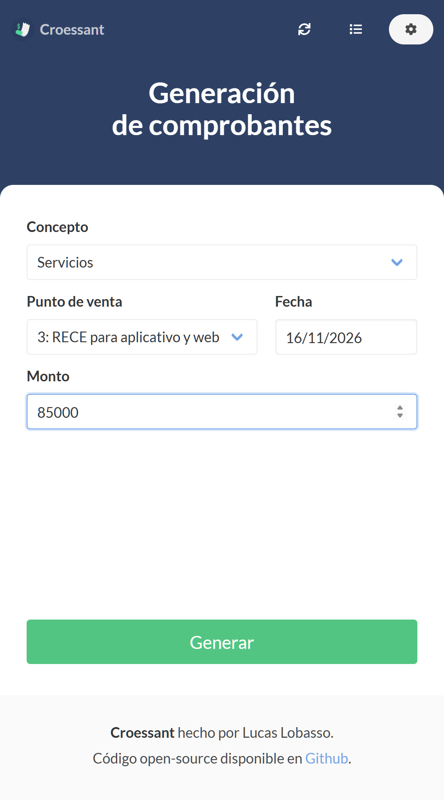
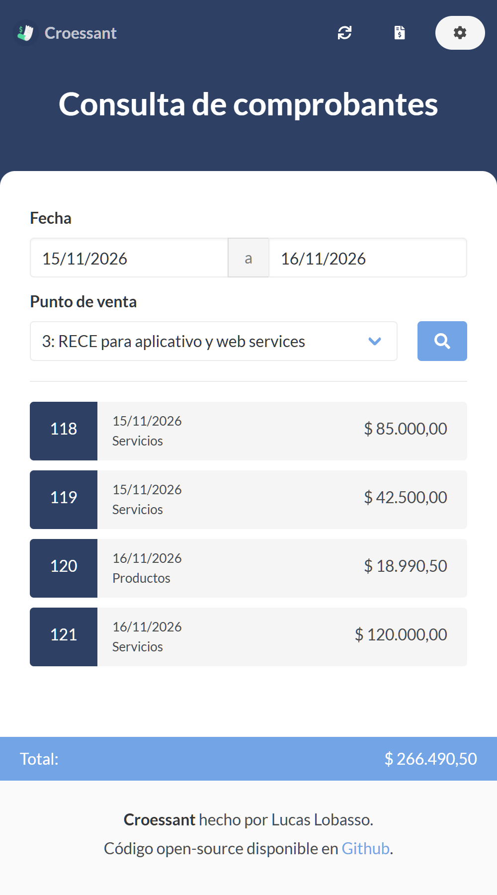
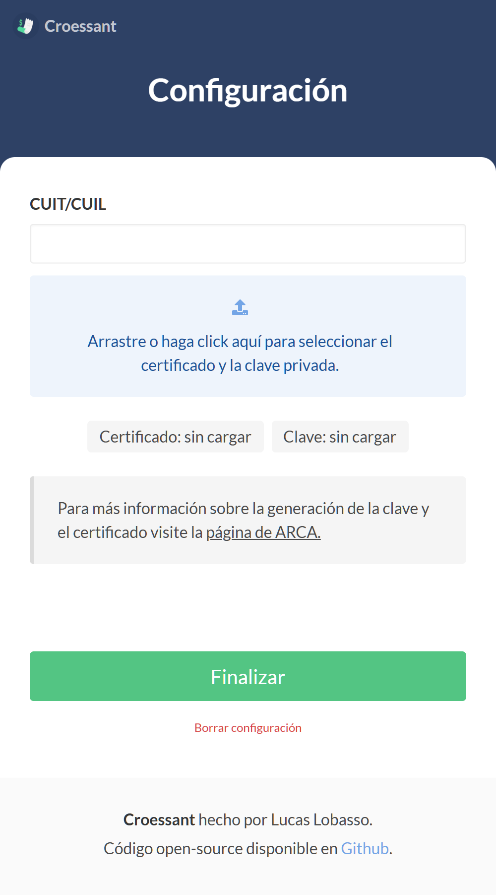
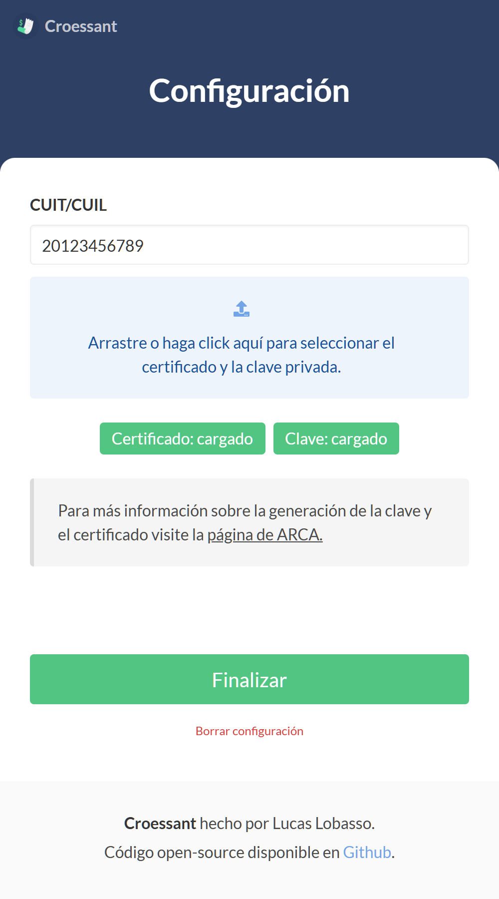
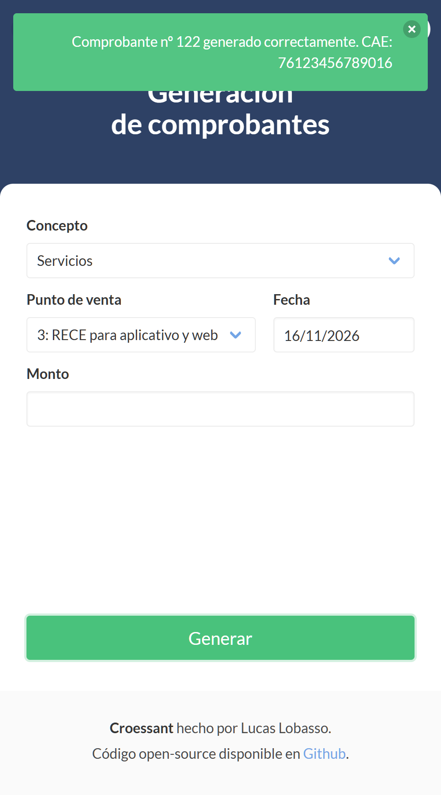
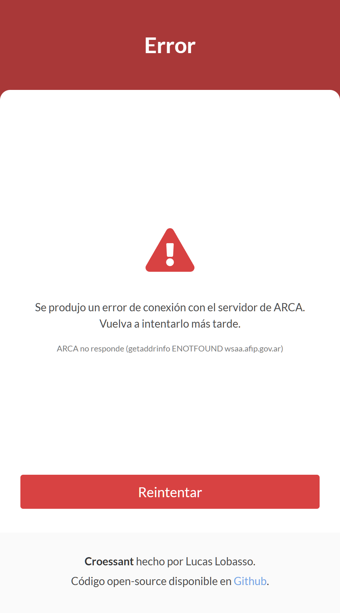

<p align="center">
  
</p>

# Croessant

[](https://github.com/lucaslobasso/croessant/actions/workflows/build.yaml)
[](https://github.com/lucaslobasso/croessant/releases/latest)
[](LICENSE.md)
[](#instalación)

<p align="center">
  
  &nbsp;
  
  &nbsp;
  
</p>

**La forma más rápida y fácil de hacer tus Facturas C.** Croessant es una aplicación de escritorio gratuita para **monotributistas** de Argentina: elegís el concepto, la fecha y el monto, y la factura queda emitida en ARCA (ex AFIP) en segundos, sin entrar a la web ni pasar por el "Comprobantes en línea".

Se conecta directo con los web services oficiales de ARCA (WSAA y WSFEv1). **Tu certificado y tu clave privada nunca salen de tu computadora** ni pasan por servicios de terceros.

> Proyecto independiente, no afiliado a ARCA.

**[Instalación](#instalación) · [Antes de empezar](#antes-de-empezar) · [Cómo se usa](#cómo-se-usa) · [Capturas](#capturas) · [Tus datos](#dónde-se-guardan-tus-datos) · [Problemas comunes](#problemas-comunes) · [Desarrollo](#desarrollo) · [Contribuir](#contribuir)**

## Instalación

Descargá el instalador de tu sistema desde **[Releases](https://github.com/lucaslobasso/croessant/releases/latest)**:

| Sistema | Archivo |
| --- | --- |
| Windows | `Croessant-x.y.z Setup.exe` |
| macOS | `Croessant-darwin-*.zip` |
| Linux | `.deb` (Debian, Ubuntu) o `.rpm` (Fedora, openSUSE) |

> En Windows y macOS la app no está firmada, así que el sistema puede avisar que es de un "editor desconocido": *Más información → Ejecutar de todas formas* (Windows) o *clic derecho → Abrir* (macOS).

## Antes de empezar

Necesitás tres cosas de ARCA (se hacen una sola vez):

1. Un **certificado digital para web services** de producción, asociado al servicio **Facturación Electrónica (wsfe)**. Al generarlo obtenés un **certificado** (`.crt`) y una **clave privada** (`.key`). Guía oficial: [arca.gob.ar/ws/documentacion/certificados.asp](https://www.arca.gob.ar/ws/documentacion/certificados.asp).
2. Un **punto de venta** habilitado para factura electrónica por **web services** (tipo "RECE para aplicativo y web services").
3. Tu **CUIT/CUIL**.

> Los certificados de ARCA vencen (normalmente a los dos años). Cuando la app te avise, generá uno nuevo y cargalo otra vez en *Configuración*.

## Cómo se usa

1. **Configuración.** La primera vez se abre esta pantalla: escribí tu CUIT/CUIL y arrastrá (o elegí) el certificado y la clave. No importa cómo se llamen los archivos.
2. **Generación de comprobantes.** Elegí el **concepto** (productos, servicios o ambos), el **punto de venta** si tenés varios, la **fecha** y el **monto**, y tocá *Generar*. Croessant solo te deja elegir fechas que ARCA acepta para ese concepto y valida el monto. Al terminar te muestra el número de comprobante y el CAE.
3. **Consulta de comprobantes.** Elegí un rango de fechas y un punto de venta para ver las facturas emitidas y el total.

Las facturas se emiten a **consumidor final sin identificar**, así que cada una tiene que ser **menor a $10.000.000** (desde ese importe ARCA exige identificar al comprador, RG 5700/2025).

## Capturas

| Pantalla | |
| --- | --- |
| Configuración, primera vez |  |
| Configuración, lista |  |
| Generar una factura |  |
| Factura generada |  |
| Consulta de comprobantes |  |
| Sin conexión con ARCA |  |

<sub>Las capturas son de las pantallas reales con datos de ejemplo (CUIT, facturas y CAE inventados): `npm run screenshots`, ver [`docs/screenshots.mjs`](docs/screenshots.mjs).</sub>

## Dónde se guardan tus datos

Solo en tu computadora, en la carpeta de datos de la aplicación: el CUIT (`cuit.txt`), el certificado (`cert.crt`), la clave privada (`key.key`) y el ticket de acceso de ARCA (`ta-*.json`).

| Sistema | Carpeta |
| --- | --- |
| Windows | `%APPDATA%\Croessant` |
| macOS | `~/Library/Application Support/Croessant` |
| Linux | `~/.config/Croessant` |

Para borrarlos usá *Borrar configuración* en la pantalla de *Configuración*.

## Problemas comunes

- **"ARCA rechazó la combinación del CUIT/CUIL y los documentos".** El certificado no corresponde al CUIT cargado, está vencido, o no está asociado al servicio *wsfe*. Revisalo en ARCA (*Administración de Certificados Digitales* y *Administrador de Relaciones*) y volvé a cargarlo.
- **"No se encontraron puntos de venta disponibles".** Creá uno en ARCA (*Administración de puntos de venta y domicilios*) del tipo *RECE para aplicativo y web services*. Puede tardar unos minutos en aparecer.
- **Error de conexión.** Los servidores de ARCA a veces no responden; esperá un rato y tocá *Reintentar*. Si pasa siempre, revisá que un firewall o antivirus no esté bloqueando la app.
- **La fecha no me deja elegir cierto día.** ARCA solo acepta fechas cercanas a hoy (±5 días para productos, ±10 para servicios) y nunca anteriores a tu última factura de ese punto de venta.

## Desarrollo

Requiere [Node.js](https://nodejs.org) 22.13 o superior.

```sh
git clone https://github.com/lucaslobasso/croessant
cd croessant
npm install
npm start              # compila los estilos y abre la aplicación
npm test               # tests unitarios (no se conectan con ARCA)
npm run make           # instaladores en out/
npm run screenshots    # regenera las capturas de docs/ (Edge, o BROWSER_CHANNEL=chrome)
```

Para probar contra el ambiente de **homologación** de ARCA (con un certificado de homologación):

```sh
CROESSANT_ENV=homologation npm start
```

Código:

- `src/arca`: cliente propio de los web services de ARCA (WSAA y WSFEv1) y reglas de facturación.
- `src/main`: configuración, IPC y preload del proceso principal de Electron. Las vistas no tienen acceso a Node: todo pasa por `window.croessant`.
- `src/views`, `src/js`, `src/scss`: las pantallas.

Los releases se generan con GitHub Actions al pushear un tag `v*` (`.github/workflows/release.yaml`).

## Contribuir

Los issues y pull requests son bienvenidos. Corré `npm test` antes de abrir un PR. Si cambiás algo visible, regenerá las capturas con `npm run screenshots`.

## Licencia

[MIT](LICENSE.md) © Lucas Lobasso
